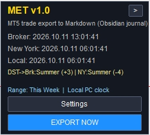
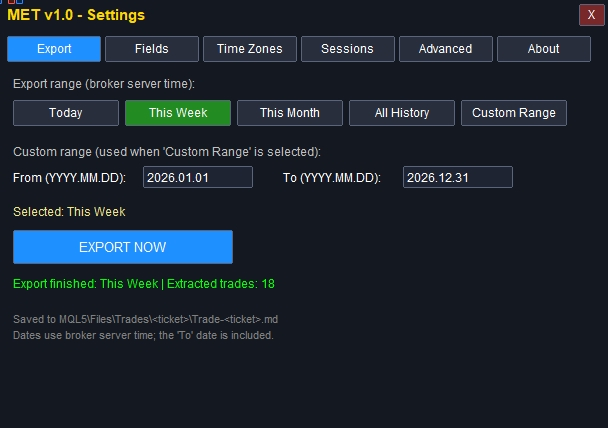
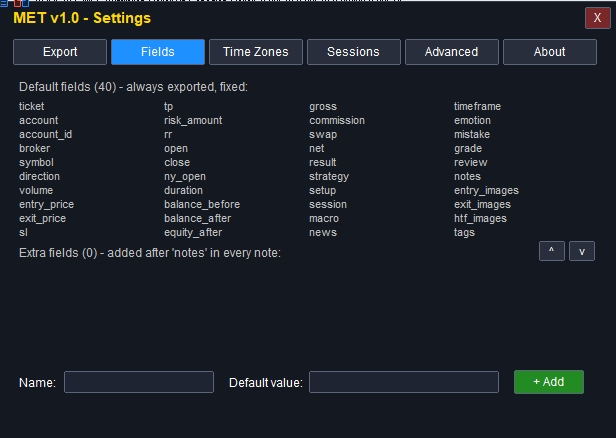
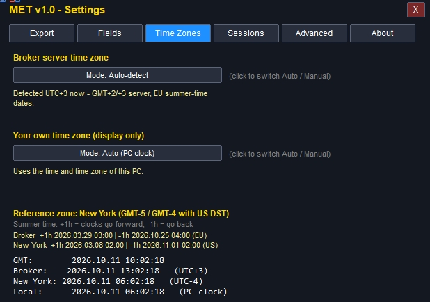
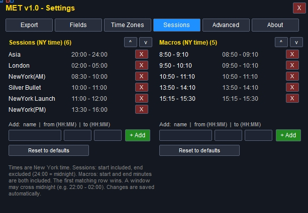
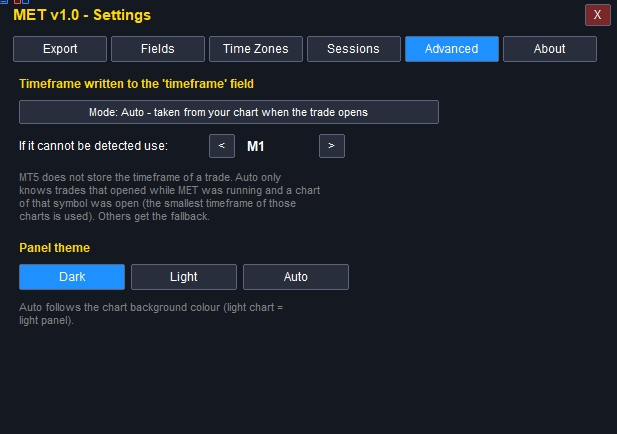
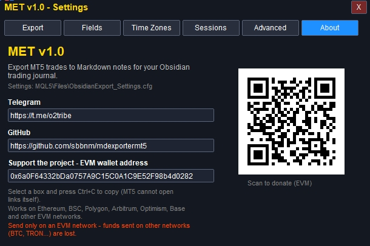
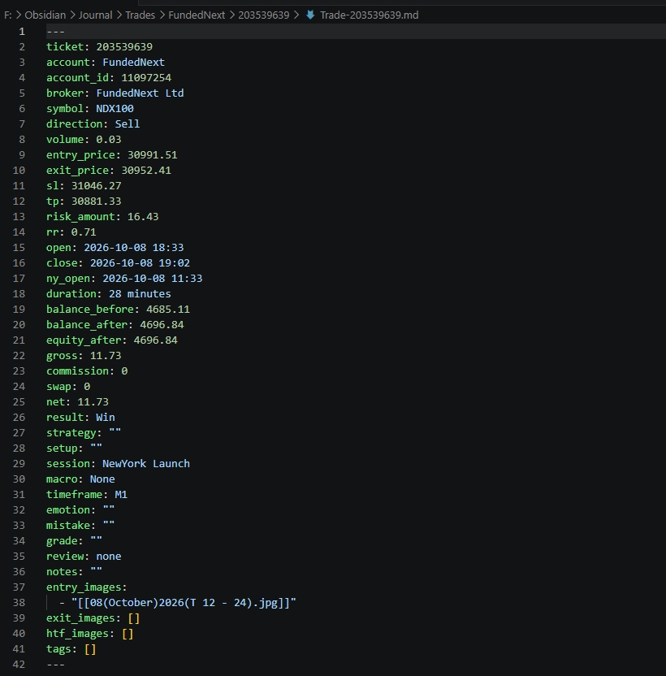

<div align="center">

# MET v1.0

**Obsidian əməliyyat jurnalınız üçün MetaTrader 5 → Markdown əməliyyat ixracatçısı**

[English](README.md) | [فارسی](README.fa.md) | [Türkçe](README.tr.md) | **Azərbaycanca**

[Telegram](https://t.me/o2tribe) · [GitHub](https://github.com/sbbnm/mdexportermt5)

</div>

---

MET, MetaTrader 5 üçün Expert Advisor-dur (EA). **Əməliyyat açmır.** Yalnız bağlanmış mövqelərinizi oxuyur və hər birini birbaşa Obsidian-a ata biləcəyiniz `.md` qeydi kimi yazır.

Hər qeydə düzgün **Nyu-York sessiyası**, **makro pəncərəsi** və **taymfreym (timeframe)** yazılır. Brokerinizin server saatı Nyu-Yorkdan fərqli olsa belə (yay/qış saatı daxil çevirmə sizin əvəzinizə edilir).

## İmkanlar

- Bağlanan hər əməliyyat üçün bir Markdown qeydi (`ticket`, simvol, istiqamət, həcm, qiymətlər, SL/TP, R:R, balans, mənfəət, komissiya, svop, müddət, nəticə və s.).
- Əməliyyat bağlanan kimi avtomatik ixrac; həmçinin Bu gün / Bu həftə / Bu ay / Bütün tarixçə / xüsusi tarix aralığı üçün əl ilə ixrac.
- Sessiya, makro və taymfreym təyini ([Sessiyalar və makrolar](#sessiyalar-və-makrolar) bölməsinə baxın).
- Broker saat qurşağının avtomatik təyini və ya istənilən UTC fərqi və yay saatı (DST) qaydası ilə əl ilə tənzimləmə.
- Redaktə oluna bilən sessiya və makro pəncərələri, əlavə xüsusi sahələr, tünd / açıq / avtomatik mövzu.
- DLL yoxdur, internet girişi yoxdur: kompüterinizdən heç nə kənara çıxmır.

<a href="https://youtu.be/CbZ8fmYc9Nw"></a>

## Ekran görüntüləri

<p align="center"><br><sub>Qrafikdə MET: sağda panel, solda parametrlər pəncərəsi</sub></p>

<table align="center">
<tr>
<td align="center"><br><sub>Qrafikdəki panel</sub></td>
<td align="center"><br><sub>Parametrlər: Export</sub></td>
</tr>
<tr>
<td align="center"><br><sub>Parametrlər: Fields</sub></td>
<td align="center"><br><sub>Parametrlər: Time Zones</sub></td>
</tr>
<tr>
<td align="center"><br><sub>Parametrlər: Sessions</sub></td>
<td align="center"><br><sub>Parametrlər: Advanced</sub></td>
</tr>
<tr>
<td align="center"><br><sub>Parametrlər: About</sub></td>
<td align="center"><br><sub>Obsidian-da ixrac olunmuş qeyd</sub></td>
</tr>
</table>

## Tələblər

- MetaTrader 5 (masaüstü versiyası), istənilən broker, demo və ya real hesab.
- Qeydlərdən istifadə üçün [Obsidian](https://obsidian.md). Yaradılan qeydlərdə Dataview (`dataviewjs`) blokları var; tam imkanlar üçün **Dataview** plaginini quraşdırın və JavaScript sorğularını aktivləşdirin.

## Quraşdırma

1. MetaTrader 5-də **File → Open Data Folder** seçiminə klikləyin.
2. Açılan pəncərədə **MQL5** qovluğunu, sonra **Experts** qovluğunu açın.
3. **`MET_1.ex5`** faylını **Experts** qovluğuna yerləşdirin (paste).
4. MetaTrader 5-ə qayıdın və **View → Navigator** seçin (və ya `Ctrl+N`).
5. Navigator-da **Expert Advisors** bölməsinə sağ klikləyib bir dəfə **Refresh** edin. **MET** siyahıda görünür.
6. **MET**-i qrafikə sürüşdürün. **Ticarət etmədiyiniz** simvolun qrafikindən istifadə etməyiniz tövsiyə olunur (ticarət qrafiklərinizlə qarışmasın deyə).
7. **Inputs** bölməsində **Account label** sahəsinə broker və ya hesab adınızı yazın (məsələn, `FundedNext`) və **OK** basın. Boş da buraxa bilərsiniz.

Panel qrafikin yuxarı sağ küncündə görünür. **Algo Trading** düyməsinin aktiv olduğundan əmin olun.

> Mənbə kodunu özünüz də kompilyasiya edə bilərsiniz: `MET.mq5` faylını MetaEditor-da açın və `F7` basın.

## Qrafikdəki panel

| Element | Nə edir |
|---|---|
| **Broker / New York / Local** | Canlı saatlar. Nyu-York saatı ABŞ yay/qış saatına avtomatik uyğunlaşır. |
| **DST sətri** | Broker və Nyu-Yorkun hazırda yay, yoxsa qış saatında olduğunu və UTC fərqlərini göstərir. |
| **Range** | Hazırda seçilmiş ixrac aralığı. |
| **Settings** | Parametrlər pəncərəsini açır (qrafikin sol tərəfində). |
| **EXPORT NOW** | Seçilmiş aralıqdakı əməliyyatları ixrac edir. |
| **`>` oxu** | Paneli gizlədir. Küncdə kiçik **`MET <`** düyməsi qalır; klikləyəndə panel yenidən görünür. |

## Parametrlər pəncərəsi (sekmələr)

### 1. Export

Nəyin ixrac olunacağını seçin və **EXPORT NOW** basın.

- **Today**, **This Week** (bazar ertəsindən), **This Month**, **All History**.
- **Custom Range**: *From* və *To* tarixlərini `YYYY.MM.DD` formatında yazın. Tarixlər broker server vaxtı ilədir və *To* tarixi daxildir.

Düymənin altındakı status sətri neçə əməliyyatın ixrac edildiyini göstərir.

### 2. Fields

- Hər qeydə yazılan **40 standart sahəni** göstərir (sabitdir, silinmir; beləliklə Obsidian panelləriniz pozulmur):

  `ticket, account, account_id, broker, symbol, direction, volume, entry_price, exit_price, sl, tp, risk_amount, rr, open, close, ny_open, duration, balance_before, balance_after, equity_after, gross, commission, swap, net, result, strategy, setup, session, macro, news, timeframe, emotion, mistake, grade, review, notes, entry_images, exit_images, htf_images, tags`

- **Əlavə sahələr**: bir *Name* və bir *Default value* yazıb **+ Add** basın. Sahə ixrac olunan bütün qeydlərə əlavə olunur (`notes`-dan sonra). Addakı boşluqlar `_` olur. **X** ilə sahə silinir. `news` sahəsi standart olaraq boşdur, özünüz doldura bilərsiniz.

### 3. Time Zones

MET hər əməliyyat vaxtını belə çevirir: **broker saatı → GMT → Nyu-York saatı → sessiya / makro**. Buna görə brokerinizin saat qurşağını bilməlidir.

- **Broker server time zone**
  - **Auto-detect** (standart): server saatını kompüterinizin saatı ilə müqayisə edir və geniş yayılmış nümunələri (Avropa və ya ABŞ yay saatı tarixləri ilə GMT+2 / GMT+3) tanıyır. Heç biri uyğun gəlməsə, təyin olunan fərqi sabit fərq kimi istifadə edir. Düymənin altındakı qeyd nəyin təyin olunduğunu bildirir. Kompüterinizin saatı və saat qurşağı düzgün olmalıdır.
  - **Manual**: bir **Preset** (şəhər) seçin və ya **Winter offset** (qışda UTC fərqi) və **Summer-time rule** (None / EU / US / Australia / New Zealand) təyin edin. Nümunələr: qışda GMT+2, yayda GMT+3 olan və Avropa tarixlərinə görə dəyişən broker → *Winter offset +2, rule EU*. Bütün il GMT+3-də sabit olan broker → *+3, rule None*.
- **Your own time zone**: yalnız göstərmək üçündür (paneldəki "Local" saatı).
- **Reference zone**: həmişə **Nyu-York** (GMT-5, ABŞ yay saatında GMT-4).
- Bu sekmə həmçinin brokerin və Nyu-Yorkun bu ilki **yay saatı dəyişmə tarixlərini** və canlı saatları göstərir. Onları brokerinizlə müqayisə edin.

### 4. Sessions

Bütün saatlar **Nyu-York vaxtı** ilədir.

- **Sessions** (əməliyyat uyğun gələn ilk sessiyanı alır, yoxdursa `Closed`): başlanğıc daxildir, bitmə daxil deyil (`24:00` = gecə yarısı).
- **Macros** (yoxdursa `None`): başlanğıc və bitmə dəqiqələrinin hər ikisi daxildir.
- Öz pəncərənizi **name**, **from** və **to** (`HH:MM`) ilə əlavə edin. Pəncərə gecə yarısını keçə bilər (məsələn, `22:00 - 02:00`). **X** sətri silir, **Reset to defaults** standart dəyərləri qaytarır. Dəyişikliklər avtomatik saxlanılır.

### 5. Advanced

- `timeframe` sahəsinə yazılacaq **Timeframe**:
  - **Auto**: MT5 əməliyyatın taymfreymini saxlamır; ona görə MET onu əməliyyat açılanda qeyd edir (həmin simvolun açıq qrafikləri arasında ən kiçik taymfreym). MET işləmədiyi vaxt və ya həmin simvolun qrafiki açıq olmadıqda açılan əməliyyatlar **ehtiyat dəyəri** alır (standart `M1`, ya da boş).
  - **Manual**: həmişə seçdiyiniz taymfreymi yazır.
- **Panel theme**: Dark, Light və ya Auto (qrafikin fon rənginə uyğunlaşır).

### 6. About

Layihə keçidləri, dəstək üçün cüzdan ünvanı və QR kod. Qutuya klikləyib `Ctrl+C` ilə kopyalayın (MT5 keçidi özü aça bilmir).

## İxrac olunan fayllar harada yerləşir?

1. MetaTrader 5-də **File → Open Data Folder** seçiminə klikləyin.
2. **MQL5** qovluğunu, sonra **Files**, sonra **Trades** qovluğunu açın.
3. Hər əməliyyatın öz ticket nömrəsi ilə ayrıca qovluğu var: `MQL5\Files\Trades\<ticket>\Trade-<ticket>.md`.
4. `.md` fayllarını (və ya bütün **Trades** qovluğunu) Obsidian vault-unuza kopyalayın.

> Əməliyyat yenidən ixrac olunarsa, `MQL5\Files` içindəki faylı üzərinə yazılır. Faylları vault-a kopyalayarkən, əvvəllər redaktə etdiyiniz qeydlərin üzərinə yazmayın.

## Sessiyalar və makrolar

Standart dəyərlər (Nyu-York vaxtı). Sessiya və makro **əməliyyatın açılış vaxtına** görə təyin olunur.

| Sessiya | Saat |
|---|---|
| Asia | 20:00 – 24:00 |
| London | 02:00 – 05:00 |
| NewYork(AM) | 08:30 – 10:00 |
| Silver Bullet | 10:00 – 11:00 |
| NewYork Launch | 11:00 – 12:00 |
| NewYork(PM) | 13:30 – 16:00 |

| Makro | Saat |
|---|---|
| 8:50 - 9:10 | 08:50 – 09:10 |
| 9:50 - 10:10 | 09:50 – 10:10 |
| 10:50 - 11:10 | 10:50 – 11:10 |
| 13:50 - 14:10 | 13:50 – 14:10 |
| 15:15 - 15:30 | 15:15 – 15:30 |

## Bilməyə dəyər

- Parametrlər `MQL5\Files\ObsidianExport_Settings.cfg` faylında saxlanılır. Hər şeyi sıfırlamaq üçün bu faylı silin.
- Mesajlar və xətalar MT5 Toolbox-dakı **Experts** sekməsində görünür.
- MET-i qoşmazdan əvvəl bağlanmış əməliyyatları **EXPORT NOW** ilə (aralığı seçərək) ixrac edə bilərsiniz.
- MET yalnız tarixçənizi oxuyur. Heç bir əməliyyatı açmır, dəyişmir və bağlamır.

## Layihəyə dəstək

MET sizə kömək edirsə, ianə ilə dəstək verə bilərsiniz (EVM ünvanı: Ethereum, BSC, Polygon, Arbitrum, Optimism, Base və digər EVM şəbəkələrində işləyir. Yalnız EVM şəbəkəsindən göndərin; BTC və ya TRON kimi digər şəbəkələrdən göndərilən vəsait itir).

```
0x6a0F64332bDa0757A9C15C0A1C9E52F98b4d0282
```


Suallar və ideyalar: [Telegram](https://t.me/o2tribe) · [GitHub Issues](https://github.com/sbbnm/mdexportermt5/issues)

## Məsuliyyətdən imtina

MET jurnal aparmaq üçün alətdir. Maliyyə məsləhəti deyil və sizin əvəzinizə əməliyyat aparmır. İxrac olunan məlumatları həmişə broker hesab çıxarışınızla müqayisə edin.
